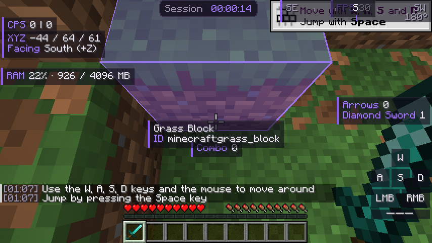

# Lumora Block-Overlay

Box um den anvisierten Block (seine echte Form, auch Stufen und Treppen): Box, nur Füllung oder nur Umrandung mit eigenen Farben, Regenbogen, Liniendicke, nur die angesehene Seite, Gleiten zwischen Blöcken (Linear, Quad, Expo), Einblenden, nur in der Ego-Perspektive und ein Blockinfo-Widget mit Name und Id.

Eingebautes Addon des Lumora Clients (Id `lumora-blockoverlay`, im Spiel: Lumora-Hub → Addons). Läuft in allen 18
unterstützten Minecraft-Versionen (1.8.9 bis 26.3). Standard: **an**.

> Dieses Repository ist eine **Kopie zum Lesen und Nachschlagen**. Das Addon ist Teil des Clients, weil es an
> Minecraft-Stellen andockt, die sich je Version unterscheiden. Gebaut, getestet und ausgeliefert wird es in
> [LumoraClient/lumora-launcher](https://github.com/LumoraClient/lumora-launcher). Eigene Addons baust du mit dem
> [Addon-Template](https://github.com/LumoraClient/lumora-addon-template).

## Einstellungen

| Schlüssel | Bedeutung |
|---|---|
| `color` | Umrandung: Farbe und Deckkraft |
| `rainbow` | Regenbogen |
| `rainbow_speed` | Regenbogen-Tempo |
| `thickness` | Liniendicke (ab 1.21.9 und in 1.8.9/1.12.2) |
| `fade` | Einblenden |
| `fade_millis` | Einblenddauer (ms) |
| `first_person_only` | Nur in der Ego-Perspektive |
| `mode` | Darstellung |
| `fill_color` | Füllung: Farbe und Deckkraft |
| `side_only` | Nur die angesehene Seite |
| `slide` | Zwischen Blöcken gleiten |
| `slide_easing` | Gleit-Kurve |
| `slide_millis` | Gleitdauer (ms) |

## Aufbau

| Ordner | Inhalt | Im Haupt-Repository |
|---|---|---|
| `src/` | Das Addon (versionsunabhängig, nur Lumora-API und Lumora-Core) und die gemeinsamen Helfer, die es braucht | `lumora-core/src/main/java/dev/lumora/core/` |
| `hooks/<version>/` | Die Andockstellen je Minecraft-Version (Mixins und Adapter) | `client/mc<version>/src/main/java/dev/lumora/client/` |
| `tests/` | Unit-Tests (laufen im Haupt-Repository) | `lumora-core/src/test/java/` |

## Lizenz

GPL-3.0-or-later (siehe `LICENSE`), wie der ganze Lumora Client.

Funktionsumfang nach FDPClient `BlockOverlay.kt` (GPL-3.0, SkidderMC) und BThack-Legacy `BlockHighlight.java` (MIT, Ferra13671); eigene Umsetzung, kein Code übernommen.
